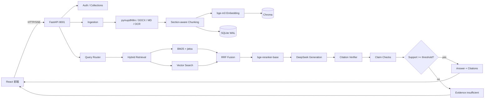

# PaperPilot 深度设计与复盘

> 一个面向科研阅读的、带引用校验的 RAG 原型。  
> 不是“套壳聊天”，重点是把“答案是否有论文证据”变成可评测、可门控、可回归的工程问题。

---

## 1. 为什么做这个项目

### 真实问题

读一篇论文时，最耗时的不是“读”，而是：

```text
找到相关段落
判断这段是否真的支持某个结论
比较多篇论文的方法
判断论文的局限和可创新点
```

普通论文问答工具的问题是：

1. 所有问题都走同一条 RAG 链路；
2. 有引用，但引用不一定支持结论；
3. 没有评测，无法判断“答得对不对”；
4. 多篇对比时，证据容易集中在一篇论文。

### 项目目标

```text
让回答可追溯
让引用可校验
让不同任务走不同链路
让低置信回答敢于拒答
让效果可以被量化
```

---

## 2. 总体架构



---

## 3. 数据入库

### 3.1 解析

默认：

```text
pymupdf4llm
```

原因：

- 比纯 `page.get_text()` 更好的阅读顺序；
- 保留 Markdown 标题；
- 轻量，不需要布局模型；
- 对论文类 PDF 足够。

备选：

```text
pymupdf（轻量 fallback）
RapidOCR（扫描件）
python-docx（DOCX）
Markdown
```

扫描件：

```text
页面文本 < 40 字
→ 渲染 PNG
→ RapidOCR
→ 页面文本
```

### 3.2 分块

当前：

```text
800 字符
100 overlap
保留 page / section / title / chunk_index
```

为什么用固定字符：

- 实现简单；
- 对中英文都能跑；
- 第一版优先跑通。

问题：

- 字符不是 token；
- 公式/表格会切断；
- 没有 parent-child；
- 跨章节的段落可能被切碎。

下一步应改：

```text
400–600 token
parent section + child chunk
相邻块扩展
表格/公式独立处理
```

### 3.3 为什么没用 Unstructured 作为默认

Unstructured 适合：

```text
Title / NarrativeText / Table / ListItem
chunk_by_title
metadata
```

但：

- `hi_res` 依赖布局模型和 OCR，重；
- 公式/跨页表格仍不保证；
- `chunk_by_title` 可能产生过长 chunk；
- 它解决“文档结构”，不解决“检索排序”。

详见 [PARSING.md](PARSING.md)。

---

## 4. 索引与检索

### 4.1 Embedding

```text
bge-m3
1024 维
normalize_embeddings=True
```

为什么：

- 中英文混合；
- 论文术语多；
- 本地可部署；
- 与 Chroma 兼容。

问题：

- 没有 query instruction；
- 长 chunk 语义被平均；
- 没有用 sparse/ColBERT 能力。

### 4.2 Chroma

```text
PersistentClient
collection: paper_chunks
cosine
metadata: paper_id / page / section / chunk_index / is_reference / title
```

为什么不用 Milvus：

- 当前单机、十几篇论文；
- Chroma 零运维；
- Milvus 更适合大规模/多租户。

### 4.3 混合检索

```text
BM25（jieba）
+
bge-m3 向量
→ RRF（k=60）
→ bge-reranker-base
```

为什么：

- BM25 对术语、数字、专有名词强；
- 向量对语义/跨语言强；
- RRF 不依赖分数尺度；
- Cross-Encoder 对 query-doc 对精排更准。

### 4.4 Reranker 为什么在 CPU

```text
bge-m3 已占 GPU
6GB 显存下同时放 reranker 容易 OOM
CPU 延迟可接受，稳定优先
```

### 4.5 多篇平衡取证

```text
每篇至少保留 per_paper 个候选
→ 合并
→ 联合 rerank
```

解决：

```text
对比题全部引用同一篇论文
```

### 4.6 Query rewrite / 章节过滤的负结果

49 条 gold：

| 模式 | recall@1 | recall@5 | recall@10 | MRR |
|---|---:|---:|---:|---:|
| baseline | 0.531 | 0.898 | 0.918 | 0.662 |
| rewrite-only | 0.531 | 0.898 | 0.918 | 0.662 |
| rewrite + section | 0.490 | 0.776 | 0.816 | 0.597 |

结论：

```text
query rewrite 没有提升
section filter 明显掉召回
```

因此默认：

```text
QUERY_REWRITE_ENABLED=false
SECTION_FILTER_ENABLED=false
```

这体现了“先评测，再保留优化”的原则。

### 4.7 邻接块扩展

生成前对 top chunks 增加前后各 1 个相邻块：

```text
提升上下文完整性
不改变离线 recall@k 的排序
```

---

## 5. 路由

```text
single     内容问答
compare    论文对比
innovate   创新点
explain    术语解释
summary    总结
clarify    条件不足
```

为什么用规则路由：

- 低延迟；
- 可解释；
- 可测试；
- 当前任务不需要自由 Agent。

为什么不用 Agent：

- 多步工具调用会增加延迟与不确定性；
- 只有“论文 + 术语库 + 网页 + 校验”才值得上 Agent。

---

## 6. 生成

### 6.1 Single

```text
只基于证据
每个事实句引用
证据不足要说明
```

### 6.2 Compare

```text
按研究问题/方法/数据/结果/局限/适用场景对比
每篇论文有证据
```

### 6.3 Innovate

```text
依据 / 研究空白 / 新在哪里 / 验证方案 / 风险
不声称绝对原创
```

### 6.4 Explain

```text
论文中的用法
+
本地术语库
+
可选通用解释
```

### 6.5 Summary

```text
分批 5000 字
→ 每批摘要
→ 单篇 reduce
→ 多篇 synthesis
```

---

## 7. 引用校验

### 7.1 流程

```text
答案 [1] [2]
→ 找到每个标记对应句子
→ 与引用 chunk 配对
→ 批量 LLM 审核
→ yes / partial / no
```

### 7.2 处理

```text
no       删除引用标记
partial  二次检索 + 补证改写
低于阈值 不展示完整答案
```

### 7.3 为什么不是“让模型再检查一遍”

因为：

- 模型可能再次幻觉；
- 需要结构化输出；
- 需要可评测的 `support` 字段；
- 需要门控，而不是只提示。

### 7.4 claim 级检查

```text
句子 → claim
claim → 引用
yes / partial / no / uncited
claim_support_rate
```

当前 `uncited` 只标记“没有引用”，还没有独立事实核查。

---

## 8. 认证、集合、流式

### 认证

```text
PBKDF2 密码
Access Token 2h
Refresh Token 30d
Token 只在数据库存 hash
401 自动 refresh + retry
```

### 集合

```text
default collection
rename / delete / move papers
owner_id 隔离
```

### 流式

```text
POST /chat/stream
event: route
event: token
event: final
```

`final` 带 citations / claims / support rate / suppression。

---

## 9. 评测

### 数据

```text
60 条题
49 条 retrieval gold
120 行 A/B 标注
```

### 指标

```text
recall@1/5/10
MRR
answer_accuracy
citation_precision
false_suppression
Cohen's kappa
```

### 结果

```text
answer_accuracy   0.750
citation_precision 0.550
recall@1          0.531
recall@5          0.898
recall@10         0.918
suppressed        14/60
```

详见 [EVAL_RESULTS.md](EVAL_RESULTS.md)。

---

## 10. 和 all-in-rag 的对应

| all-in-rag | PaperPilot | 差异 |
|---|---|---|
| C1 RAG 基础 | 基础 RAG + 引用 | 增加引用校验 |
| C2 数据加载/分块 | pymupdf4llm / DOCX / MD / OCR | 未默认用 Unstructured |
| C3 索引构建 | bge-m3 + Chroma | 单机而非 Milvus |
| C4 混合检索 | BM25 + 向量 + RRF + reranker | 增加 per-paper 平衡 |
| C5 生成集成 | FastAPI + DeepSeek + SSE | 增加流式 |
| C6 评估 | 60 题 + recall + citation + kappa | 更贴近论文场景 |
| C7 高级 RAG | 6 路路由 + verifier + gate | 不是自由 Agent |
| C8 项目实战 | React 单前端 + 登录/集合 | 端到端产品化 |

### 复习建议

```text
C1：看基础 RAG 流程
C2：对照分块/Unstructured 的取舍
C3：对照 bge/Chroma vs Milvus
C4：重点看 hybrid、RRF、rerank、routing
C5：看 Prompt/结构化输出
C6：看 recall、citation precision、kappa
C7：看 adaptive routing、claim/gate
C8：看 React/SSE/auth/collections
```

---

## 11. 简历 bullet

```text
- 独立实现 PaperPilot 论文阅读 RAG，支持 PDF/DOCX/Markdown、
  混合检索、多论文对比、术语解释、总结与 SSE 流式问答。
- 设计 6 路自适应路由，将内容问答、论文对比、创新点、术语解释、
  总结和条件不足分流处理。
- 构建 BM25 + bge-m3 + RRF + bge-reranker 检索链路，
  多篇任务实现 per-paper 平衡取证。
- 设计引用支持校验、partial 二次检索、claim 检查和低支持率门控，
  将“引用是否支持结论”变成可评测指标。
- 建立 60 题评测集、49 条 retrieval gold 和 120 行双人标注，
  量化 recall@5、citation precision、answer accuracy 与 kappa。
```

---

## 12. 边界

```text
单机
单用户
14 篇论文
不是生产系统
Docker 未完成构建
```

不能宣称：

```text
生产准确率
跨领域泛化
高并发
多租户
```

---

## 13. 下一步

```text
1. parent-child chunk
2. 相邻块扩展 + reranker 调优
3. recall@1 从 0.531 提到 0.65
4. citation precision 从 0.55 提到 0.75
5. 100–200 条双人 gold
6. PDF.js 内嵌高亮
7. Docker/CI
```
